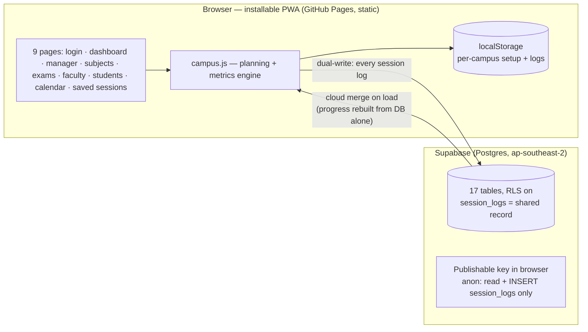

# Design Document — Mirai Progression Tracker

*Student Challenge Problem 1 · Course Progression Tracker · ≤3 pages*

## 1. Purpose and principles

The tracker replaces hand-maintained syllabus spreadsheets at MSOT. Every design
decision maps to one of the brief's three principles:

| Principle | How the design honours it |
| --- | --- |
| **Effortless** | Session logging is one dialog, pre-filled from the timetable (subject → next incomplete topic → status → %), plus a one-line Quick Log (`sub:topic:status:pct`). Phone-first layout, large tap targets, works offline. |
| **Accurate** | One calculation engine (`campus.js`) is the single source of truth for dates, coverage, buffer and pace. Every figure on every page is computed from the same logged sessions + calendar — never typed in, never hardcoded. |
| **Early warning** | Buffer ratio and pace are computed continuously per subject; danger subjects, overdue topics and missed-log alerts (end-of-day reminder, 48-hour escalation to the Campus Controller) surface weeks before exams, not days. |

## 2. Architecture

**Local-first, cloud-mirrored.** Logging never waits on the network: the session
is written to localStorage (the engine's working state) and mirrored to Supabase
`session_logs`. On load, every dashboard fetches the cloud logs and merges them
(deduplicated, label-resolved) before computing — so a fresh browser on any
machine rebuilds the true progress from the database alone, and the Saved
Sessions page is a pure database view.

## 3. Components

| Piece | Responsibility |
| --- | --- |
| `index.html` | Role login — Student (roster name picker), Faculty (member picker), Manager |
| `dashboard.html` | Faculty/student home: subject cards, needs-attention, exam readiness, timetable, alerts, Log Session + Quick Log, faculty focus + student personal hero |
| `manager.html` | Campus Controller: per-campus setup editor (7 tabs), campus switcher, controller activity, view-as |
| `subjects.html` / `exams.html` | Topic-level subject detail; exam-scope readiness (faculty see their own subjects first) |
| `faculty.html` / `students.html` | People directories with per-person homework + feedback, from the same log store |
| `calendar.html` | Month grid (holidays/exams), 60-day upcoming, Google Calendar links, .ics export |
| `saved-sessions.html` | Database-backed session history (faculty: own; manager: all, filterable) |
| `campus.js` | **The engine** — setup state per campus, planned-date walker, metrics |
| `supabase.js` | Supabase client, dual-write, cloud-entry conversion + merge |
| `students.js` | The real 119-student roster (Sections A & B) |
| `starfield.js`, `mobile.css`, `sw.js` | Brand background, phone layout + bottom nav, PWA offline shell |

## 4. Data model

Reference data lives in Postgres (`supabase/schema-v2.sql`): `campuses`,
`sessions`, `semesters`, `holidays`, `students`, `faculty`, `subjects`,
`faculty_subjects`, `topics`, `subtopics`, `timetable`, `session_logs`,
`lesson_plans`, `feedback`, `exams`, `exam_scope`, `summary_cache`.
IDs are stable text slugs (`vishal`, `dsa`) shared by the seed, the API and the
frontend, so a log written by any client resolves identically everywhere.
The browser keeps the *working* copy of setup + logs per campus in localStorage
(`mirai_campuses_v1`), which is also the offline mode.

## 5. Calculation engine (brief §3, unchanged)

- **Hours in scope** = planned hours of all topics, excluding Skipped.
- **Covered hours** = Completed topics in full; In Progress × % complete.
- **Coverage %** = covered ÷ in-scope. **All percentages are hours-weighted**,
  never topic counts.
- **Available hours** = timetable hours on working days from today to the
  subject's target finish (working-Saturday rule: all / none / 1st & 3rd /
  2nd & 4th; holidays excluded).
- **Buffer** = available ÷ remaining → **≥ 1.15 ON TRACK · 1.00–1.15 TIGHT ·
  < 1.00 DANGER**.
- **Pace** = covered − should-be-covered by today. **Track rollup = the worst
  subject**, never an average.
- **Planned dates**: each topic is dated by walking the calendar forward and
  spending each weekday's timetable hours; holidays and Cancelled sessions
  consume no hours, so every later date shifts automatically.
- **Exam readiness**: per exam, % of in-scope topics covered (hours-weighted)
  and hours still needed before the exam date, from the real `exam_scope`.

## 6. Roles and permissions (brief §4)

| Role | In this build |
| --- | --- |
| Manager (Campus Controller) | All campuses, setup editor, all logs, controller activity, view-as any role |
| Faculty | Log sessions **only for their own subjects** (the dialog offers nothing else), own-subject dashboard focus, own saved sessions |
| Student | Read-only: covered topics, Up Next, exam dates + scope, personal dashboard with recent homework. No logging, no setup, no Sessions section |

*Honest boundary:* role selection is client-side in this challenge build (demo
login); the database enforces the data rules that matter (anon can only read
and insert session logs). Production hardening = Supabase Auth with per-user
RLS policies, for which the slug IDs and policy shape are already prepared.

## 7. Scaling and performance

Static hosting + managed Postgres scales horizontally by construction: the
end-of-day logging spike is a set of small independent inserts; dashboards
compute client-side from one `session_logs` read. Measured load and dashboard
timings are in **TEST-REPORT.md** (TR-06), including the sandbox-proxy caveat
and the campus-network re-run protocol.

## 8. Key trade-offs

- **No framework, no build step** — vanilla JS + one shared engine file: the
  whole app is inspectable, runs from any static host, and a faculty phone
  never downloads a framework to log a class.
- **Rule-based status, no ML** — buffer/pace thresholds are the institution's
  own Excel rules, reproduced exactly so figures match the existing tracker
  to 2 decimal places (TR-01).
- **Dual-write over API-first** — logging must work in a classroom with poor
  connectivity; the mirror + merge design keeps one database truth without
  ever blocking the 60-second logging budget.
